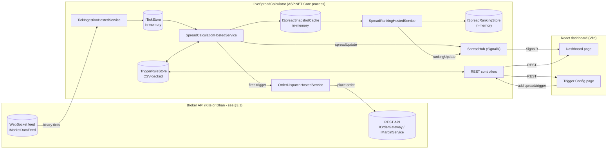

# SpreadTrader - Technical Architecture

This document describes what the system does, how the pieces fit together, and the reasoning
behind the main design decisions. For step-by-step setup/run instructions see `README.md` -
this document is the "how and why it's built this way" companion to that.

## 1. What this system does

SpreadTrader watches calendar spreads (e.g. a stock's July future vs its August future) on the
NSE/NFO segment, live, through a broker API - either Zerodha Kite Connect or DhanHQ, selected by a
single configuration flag (see §3.1). For each configured pair of contracts it:

1. Streams tick-by-tick market depth over a WebSocket.
2. Computes the spread as `FarLeg.BestAsk - NearLeg.BestAsk` (best **ask** price, not last
   traded price - see §5).
3. Ranks every spread by `|spread %|` on a slow timer, so "what's moving the most right now"
   is visible without staring at a wall of numbers.
4. Evaluates user-defined trigger rules against the live spread value.
5. When a rule fires, dispatches a basket order (one or two legs) through the broker's order API.
6. Pushes all of the above to a React dashboard in real time over SignalR.

Nothing about market data is persisted - it only ever exists in process memory, and is
recomputed from the next tick after any restart. Trigger *rule definitions* are the one
exception: they're written to a CSV file so your configuration survives a restart (see §7).

## 2. High-level architecture



Everything inside the `Api` box runs **in one process**. This is deliberate, not a
simplification taken for lack of time - see §8 (Singleton constraint).

## 3. Projects and what each one owns

| Project | Type | Owns |
|---|---|---|
| `SpreadTrader.Core` | class library | Domain models (`Tick`, `SpreadDefinition`, `SpreadSnapshot`, `SpreadRanking`, `TriggerRule`, `TriggerEvent`, order request/result types) and the interfaces everything else codes against (`ITickStore`, `ISpreadDefinitionStore`, `ISpreadSnapshotCache`, `ISpreadRankingStore`, `ITriggerRuleStore`, `ISpreadPublisher`, `ITriggerEventSink`, `IOrderGateway`), plus their default (in-memory / CSV) implementations. Also owns the **broker abstraction** in `Brokers/` - see §3.1. No dependency on ASP.NET Core, any broker, or anything external. |
| `SpreadTrader.KiteIntegration` | class library | Everything that talks to Zerodha: `KiteAuthService` (login URL + request-token exchange), `InstrumentMasterService` (instrument CSV download/cache/futures export), `KiteTickPacketParser` + `KiteTickerClient` (the binary WebSocket protocol, reconnect/resubscribe logic), `KiteOrderGateway` (rate-limited REST order placement), `KiteMarginService`, `KitePositionsService`. Depends on `SpreadTrader.Core` only. |
| `SpreadTrader.DhanIntegration` | class library | The same seven responsibilities against DhanHQ API v2: `DhanAuthService` (static-token or consent flow), `DhanInstrumentMasterService` (scrip-master CSV), `DhanTickPacketParser` + `DhanMarketFeedClient` (Dhan's binary feed plus its separate order-update socket), `DhanOrderGateway`, `DhanMarginService`, `DhanPositionsService`, and `DhanSymbology` - the one translation table between the app's vocabulary and Dhan's. Depends on `SpreadTrader.Core` only. |
| `SpreadTrader.Engine` | class library | The four hosted (background) services that make up the live pipeline - see §4. Depends on **`Core` only** - it does not reference either broker project, which is what stops broker-specific behaviour leaking into trading logic (a compile error is the backstop). Not a standalone executable - `Program.cs`/`Worker.cs` in this project are empty placeholders; the services are registered directly into the Api project's DI container. |
| `LiveSpreadCalculator` | ASP.NET Core Web Api | Hosts everything: wires the entire DI graph (`Program.cs`), exposes REST controllers, hosts the SignalR hub, and is the one process you actually run for the backend. |
| `SpreadTrader.Dashboard/spreadtrader.dashboard.client` | React (Vite) SPA | The UI - see §9. |

## 3.1 The broker abstraction (Kite / Dhan)

The platform the engine trades through is chosen by **one configuration flag**:

```json
"Broker": { "Platform": "Kite" }   // or "Dhan"
```

Everything broker-specific sits behind seven interfaces in `SpreadTrader.Core/Brokers/`:

| Interface | Responsibility | Kite | Dhan |
|---|---|---|---|
| `IBrokerSession` | Holds the live access token + account id | `KiteSession` | `DhanSession` |
| `IBrokerAuthService` | Login URL, callback exchange, token verification, token expiry | `KiteAuthService` | `DhanAuthService` |
| `IBrokerInstrumentMaster` | Symbol → numeric token resolution, futures enumeration | `InstrumentMasterService` | `DhanInstrumentMasterService` |
| `IMarketDataFeed` | The live tick socket + order-update signal | `KiteTickerClient` | `DhanMarketFeedClient` |
| `IOrderGateway` | Order placement/cancellation with fill verification | `KiteOrderGateway` | `DhanOrderGateway` |
| `IMarginService` | Basket margin + available margin | `KiteMarginService` | `DhanMarginService` |
| `IPositionsService` | Open positions + PNL | `KitePositionsService` | `DhanPositionsService` |

`LiveSpreadCalculator/Brokers/BrokerRegistration.cs` is the only place the flag is read: it
registers exactly one platform's implementations against those interfaces. The choice is made once
at startup, never per call - a half-Kite/half-Dhan process would be genuinely dangerous in
something that places real orders, and per-call branching would put a platform check in the hot
tick path for nothing.

**The engine keeps its own vocabulary.** Rather than rewriting every service, CSV column and UI
label to a third neutral vocabulary, the app keeps the Kite-flavoured terms it was built with -
exchanges `NFO`/`MCX`, products `NRML`/`MIS`, order statuses `COMPLETE`/`REJECTED`/`OPEN` - and the
Dhan adapter translates at its own boundary via `DhanSymbology`. So `NRML` becomes Dhan's `MARGIN`,
`NSE_FNO` becomes `NFO`, `TRADED` becomes `COMPLETE`, and `FUTSTK`/`FUTIDX`/`FUTCOM` all normalize
to `FUT`. That table is the single reviewable place where a wrong mapping would send a real order
to the wrong product or contract.

### What actually differs between the two platforms

These are the differences the adapters exist to absorb - worth knowing before touching either:

- **Feed encoding.** Kite is big-endian with int32 prices in paise (÷100); Dhan is little-endian
  with IEEE-754 float32 prices already in rupees. Kite frames a message as "packet count then
  length-prefixed packets"; Dhan puts a length in each packet's own header and can pack several
  into one WebSocket frame.
- **Subscriptions.** Kite subscribes by a globally unique `instrument_token`. Dhan needs
  `(exchangeSegment, securityId)` and caps a subscription message at 100 instruments, so
  `DhanMarketFeedClient` resolves segments from the instrument master and batches. `IMarketDataFeed`
  still takes plain tokens, so no call site has to carry broker-shaped data.
- **Order updates.** Kite multiplexes order postbacks onto the ticker socket; Dhan has a separate
  order-update socket with its own JSON login. `DhanMarketFeedClient` runs both and raises one
  `OrderUpdateReceived`.
- **Order addressing.** Kite orders carry a tradingsymbol; Dhan orders carry a `securityId` and no
  symbol at all. `OrderLegRequest.InstrumentToken` carries the already-resolved token so the Dhan
  gateway never has to re-resolve a symbol that the engine already pinned down.
- **Login is the biggest behavioural difference - see below.**
- **Token lifetime.** Kite invalidates every token at ~6:00 AM IST daily; every Dhan token
  currently runs a fixed 24 hours from issue, however it was obtained (portal, consent, or TOTP -
  Dhan removed the longer-lived portal option this app originally supported). The dashboard's
  token cache doesn't hardcode either schedule - the backend returns the expiry with the token.
- **Margin.** Kite has a basket-margin endpoint and per-segment funds; Dhan has
  `/margincalculator/multi` and an account-wide `/fundlimit` (so the `segment` argument is ignored
  on Dhan, without loss of accuracy - the figure is already net of everything blocked).
- **Live PNL is computed locally on both, but from different inputs - see below.**

### Live PNL: two WebSockets plus a *reactive* REST poll

Neither broker streams PNL. Both are handled the same way, and it is worth being explicit about
the shape because the naive alternative - polling the positions endpoint on a fast timer - would
burn the rate limit and still lag the market:

1. **Market-feed WebSocket** streams tick-by-tick prices into `ITickStore`.
2. **Order-update WebSocket** signals that *some* order changed state (`OrderUpdateReceived`).
3. **REST positions fetch runs ONLY on that signal** - there is no timer at all. `PositionsCache`
   blocks on the order-update event; a burst of alerts from one basket coalesces into a single
   fetch, and a fetch that fails right after an execution retries with backoff until it succeeds.
   The only other fetch is the startup one (retried until the first snapshot lands, so completing
   the broker login populates the cache without waiting for a trade). Zero requests at idle.
   Accepted trade-off: a lost order-update message (socket mid-reconnect exactly when a trade
   placed in the broker's own app fills) stays invisible until the next order event. The escape
   hatch is the Positions page's manual refresh: `GET /api/positions` goes through
   `PositionsCache.RefreshAsync`, so its one broker call both serves the response and re-anchors
   the cache - healing the PNL alerts and the live push too, not just the page.
4. **PNL is then computed locally on every tick** by `PositionsCache.GetProjected()`, so the
   dashboard updates continuously between REST fetches.

Step 4 is where the platforms genuinely differ, because they hand back different raw material:

| | Kite | Dhan |
|---|---|---|
| PNL fields on a position | one combined `pnl` | `realizedProfit` **and** `unrealizedProfit`, separately |
| Last traded price on a position | `last_price` | **not returned at all** |
| Projection used | `pnl + qty × (ltp − last_price)` | `realized + qty × (ltp − avg_price)` |

Kite supplies the mark its `pnl` was struck at, so the live figure is that snapshot adjusted by
how far price has moved since. Dhan supplies no mark at all, so the unrealised half is instead
recomputed from scratch each tick off the average price - which needs no reference price from the
broker and is exact at every tick.

Using Kite's delta formula on Dhan was a real bug: the adapter fills `LastPrice` from the local
tick store, which is `0` until that instrument's first tick arrives, and a zero baseline turns the
delta term into `qty × ltp` - adding the position's entire notional to PNL (~₹7.5 lakh on 500
RELIANCE) on the Positions & PNL page *and* in `PnlAlertHostedService`, which fires real alerts off
these numbers. See `PositionsCache.ProjectPnl`.

### Authentication: Kite requires a login, Dhan doesn't (and can log itself back in)

This is the one place the two platforms differ in *kind* rather than in wire format, so the app
models both rather than assuming Kite's. Dhan itself further splits into three ways to obtain a
token, selected by `Dhan:AuthMode` plus whether consent credentials happen to also be set - see
`DhanOptions`'s class doc comment for the full decision table.

| | Kite | Dhan (Static) | Dhan (Totp) | Dhan (Consent) |
|---|---|---|---|---|
| Browser login | **Mandatory**, every trading day | None | None, ever | Optional, only for a registered partner app |
| Human effort, ongoing | Daily login | Paste a fresh token roughly daily | **None** - fully automatic | Daily login if used as the primary path |
| How a token is obtained | OAuth-style redirect: login URL built from the api_key → back with `request_token` → exchanged using a SHA-256 checksum | Generated once in the Dhan web portal, pasted into config | `DhanTotpAutoRenewalHostedService` computes an RFC 6238 code from a stored TOTP seed and calls `generateAccessToken` with it + the account PIN - see below | Server-to-server `generate-consent` → browser login → back with `tokenId` → `consumeApp-consent` |
| Token lifetime | Dies at ~6:00 AM IST daily, regardless of when issued | 24 hours (Dhan's current portal validity) | 24 hours, renewed automatically ~1h before expiry | 24 hours |
| `SupportsInteractiveLogin` | Always true | False (unless consent creds are also set) | False (never needed) | True |

**TOTP mode trades a bigger secret for zero manual effort.** `Dhan:Pin` and `Dhan:TotpSecret`
(the same base32 seed you'd otherwise scan into an authenticator app - see Dhan Web → Profile →
DhanHQ Trading APIs → Setup TOTP) together let the app mint a valid token at will, indefinitely -
unlike a leaked access token, which is self-limiting because it expires within 24 hours regardless
of what anyone does with it. `DhanOptions.TotpSecret`'s doc comment spells out the handling this
implies: environment variable or user-secrets only, never a committed file, rotated (not just
reset) if it ever leaks.

`DhanTotpAutoRenewalHostedService` (only registered when `Dhan:AuthMode` is `"Totp"` - see
`BrokerRegistration.AddDhan`) mints a token in exactly three situations: at startup (retried with
backoff until it succeeds, so the app is authenticated within seconds of boot with zero
configuration beyond the three TOTP values); proactively, about an hour before the current token's
own expiry, so an ordinary trading request essentially never meets an expired token; and reactively,
the instant `DhanSession.SessionInvalidated` fires (Dhan revoking a token early, a login from
elsewhere, or any REST/feed call surfacing a dead session) - the same event
`DhanAuthFailureHandler.InvalidateAsync` raises via `DhanSession.ClearAccessToken()`. A failed
renewal attempt is retried with exponential backoff (2s → 30s cap) rather than giving up, since
unlike a login button there is no operator standing by to click "try again."

Four consequences shaped the code:

1. **`BuildLoginUrlAsync` is async.** Kite's login URL is a pure string; Dhan's consent flow
   requires a server-to-server consent call first to mint the id it is keyed by. TOTP mode never
   calls this at all - `GenerateAccessTokenViaTotpAsync` is a separate entry point on
   `DhanAuthService`, driven by the hosted service above, not by anything the dashboard calls.
2. **`/api/auth/callback` hands the whole query string to the adapter** instead of naming a
   parameter, since Kite redirects with `request_token`+`status` and Dhan's consent flow with
   `tokenId`. One callback serves both; TOTP mode never reaches it.
3. **`POST /api/auth/broker-token` exists for the no-login case.** On Dhan with a portal token
   (Static mode) there is no login flow to fall back on, so when that token expires - or the
   auth-failure handler invalidates it mid-session - there would otherwise be no way to recover
   without editing configuration and restarting a live process holding open positions. That
   endpoint takes a pasted token, verifies it against the broker, and installs it immediately. The
   dashboard shows an "Enter token" action instead of a login button whenever
   `SupportsInteractiveLogin` is false - which in TOTP mode simply never needs using, since the
   hosted service above heals a dead session before an operator would notice.
4. **`DhanSession.SessionInvalidated`** is the one piece of plumbing TOTP mode needed that Static
   mode has no use for: a way for "the token just died" to wake a background loop instead of
   waiting on either a human or a fixed timer.

Token expiry is computed server-side per platform (`IBrokerAuthService.GetTokenExpiryUtc`) and
returned with the token, so the dashboard's restore cache doesn't hardcode Kite's daily cutoff.

### Switching platforms

Set `Broker:Platform` (or `Broker__Platform`), supply that broker's credentials, restart, then
**rebuild the universe once** (`POST /api/universe/build`). The two platforms use different
tradingsymbols (`RELIANCE26JULFUT` vs `RELIANCE-Jul2026-FUT`) and different instrument ids, so
spread definitions resolved against one cannot be reused against the other. This is cheap because
spread definitions are in-memory only and trigger rules are cleared daily anyway (§7).

Dhan additionally requires the deployment's outbound IP to be whitelisted before order placement
works - data APIs work without it. Same requirement `zerodha-ip-whitelist.txt` documents for Kite.

### Instrument master refresh never blocks a live request

Both instrument masters cache their scrip dump for 12 hours and reload lazily by default - the
first caller after that window expires would otherwise pay the download+parse cost inline. That
matters most on Dhan: its scrip master is one flat file covering every exchange and instrument
type (there's no exchange-scoped endpoint), currently ~26 MB, and several live endpoints call
`EnsureLoadedAsync` directly in their request path (`GET /api/instruments/futures*` - the Add
Spread pickers, `GET /api/positions`, `POST /api/spreads`).

`InstrumentMasterRefreshHostedService` (broker-agnostic - it depends on `IBrokerInstrumentMaster`
only, so it protects Kite's smaller per-exchange dump too) calls `EnsureLoadedAsync` on its own
3-hour timer, comfortably inside the 12-hour cache window, so by the time any real request arrives
the cache is already fresh and that request's own call is a same-thread, no-I/O no-op. The lazy
on-demand path in each instrument master is unchanged and remains the safety net for the gap
between process startup and this loop's first tick.

On Dhan, `DhanInstrumentMasterService` also sends the previous response's `ETag` as
`If-None-Match` on every refresh - confirmed against the live CDN (CloudFront) to actually honour
this and answer with `304 Not Modified` when nothing has changed, rather than assumed. A refresh
where the file is unchanged therefore costs one small request instead of a fresh 26 MB
download-and-reparse, which is what makes refreshing every 3 hours (rather than once a day) cheap
enough to be worth doing - lot size and tick size can both change between exchange-driven
revisions, and order pricing/quantity depend on them being current (see `ParseTickSize`'s doc
comment), so a long cache lifetime trades real correctness risk for a network-cost saving that
this ETag check makes unnecessary to trade away in the first place.

## 4. The Engine pipeline

Four `BackgroundService`s, registered as singletons, running for the life of the process:

1. **`TickIngestionHostedService`** - on startup, resolves every configured spread's near/far
   tradingsymbols to Kite `instrument_token`s (via `InstrumentMasterService`), then opens and
   owns the **single** WebSocket connection to Kite (`KiteTickerClient`), subscribed in `"full"`
   mode. Every tick received is written into `ITickStore` (a `ConcurrentDictionary`). Also
   exposes `ResolveAndSubscribeAsync(spread)`, called by `SpreadsController` when a new spread
   is added at runtime, so new symbols start streaming immediately without a restart.

2. **`SpreadCalculationHostedService`** - on a timer (`Engine:SpreadRecalculationIntervalMs`,
   default 300ms), reads the latest tick for each spread's two legs from `ITickStore`, computes
   `SpreadValue = FarAsk - NearAsk` and `SpreadPercent = SpreadValue / NearAsk * 100`, always
   updates `ISpreadSnapshotCache` (so the value is available even between "changed" pushes), and
   - if the value actually changed since last cycle - adds it to a batch pushed to the dashboard
   as one `"spreadUpdate"` SignalR message. In the same pass, evaluates every trigger rule
   attached to that spread (see §6) and, if one fires, publishes a `TriggerEvent` to both the
   SignalR hub (`"triggerFired"`) and an internal channel that `OrderDispatchHostedService`
   consumes.

3. **`SpreadRankingHostedService`** - on a much slower timer
   (`Engine:RankingIntervalMinutes`, default 3), reads every spread's latest snapshot from
   `ISpreadSnapshotCache`, sorts by `|SpreadPercent|` descending, assigns a 1-based rank, stores
   the result in `ISpreadRankingStore`, and pushes it as `"rankingUpdate"`. Deliberately
   decoupled from the fast recalculation loop - re-sorting the whole spread list every 300ms
   would just flicker; a "what's moving the most" summary only needs to update every few
   minutes.

4. **`OrderDispatchHostedService`** - consumes fired `TriggerEvent`s off an internal
   `System.Threading.Channels.Channel<T>` (decoupling order placement from tick processing, so a
   slow/erroring Kite API call never blocks the tick loop), builds one or two `OrderLegRequest`s
   per event (direction resolved per §6), and dispatches each sequentially through
   `IOrderGateway`, which internally paces itself under Kite's order-placement rate limit.

## 5. Why bid/ask depth, not last traded price

Trigger thresholds are judged against live market depth, never last traded price (LTP) - LTP
only updates when a trade actually happens and can be stale between prints. But it's also not a
flat ask-vs-ask comparison: `SpreadCalculationHostedService.RunCycleAsync` first compares the two
legs' **ask** prices to decide direction (near month in premium -> you'd sell it; at a discount
-> you'd buy it - see §6), then prices each leg on the side you'd actually trade it - the leg
you'd **buy** at its **ask** (what you'd pay), the leg you'd **sell** at its **bid** (what you'd
receive). This makes `SpreadValue` the realistically executable spread, not an optimistic number
that ignores the bid/ask cost of actually putting the trade on. If the bid needed to price a sell
leg hasn't arrived yet (bid depth updates lag ask depth, especially on far-month contracts), the
service falls back to that leg's ask rather than hiding the spread entirely - `Direction` on the
snapshot is suffixed `"(bid pending)"` in that case so the UI can show it's a provisional value.

Kite only includes market depth in **`"full"`** ticker mode (`Kite:TickerMode` in
`appsettings.json`) - `"quote"`/`"ltp"` modes carry LTP/OHLC but no bid/ask at all.
`KiteTickPacketParser` reads the first bid/offer entries out of the 184-byte full-mode packet
(bytes 68-72 and 128-132 respectively) into `Tick.BestBidPrice` / `Tick.BestAskPrice`. Full mode
costs more bandwidth/CPU than quote mode (depth changes push extra ticks) - an acceptable
tradeoff at ~100-200 instruments, worth reconsidering if the instrument count grows much
further.

## 6. Trigger evaluation and order direction

A `TriggerRule` has an `Operator` (`>=` or `<=`) and a `Threshold` against `SpreadValue` (or
`SpreadPercent`, when `ThresholdIsPercent` is set) - a plain signed comparison value, not a
deviation magnitude. Two extra pieces of state make repeated firing safe:

- **`IsArmed`** - a rule only fires while armed. After firing, it disarms. If `OneShot` is true
  (the default), it also disables itself entirely and needs a manual re-enable (which re-arms
  it) before it can fire again. If `OneShot` is false, `MaxFireCount` takes over instead: the
  rule schedules exactly that many total shots, firing the next one as soon as the condition is
  true again and the previous shot's basket dispatch has resolved (filled or rejected - see
  `TriggerInFlightTracker`), with no re-arm/hysteresis wait required. (An older "stand
  indefinitely, re-arm once the spread retreats past a buffer" mode - `RearmBuffer` - existed
  here previously and has since been removed, including its column in `triggers.csv`.)
- **`MinFireIntervalPerRuleMs`** - a floor on how often *any* rule can re-fire, independent of
  arming, as a last-resort guard against a burst of duplicate orders off one noisy price move.

**Order direction** is always taken directly from the rule's fixed `NearLegAction`/`FarLegAction`
(`None`/`Buy`/`Sell`, set explicitly when the rule is created) - `OrderDispatchHostedService.
BuildLegs` uses them as-is. An earlier "auto-direction" mode (`AutoDirectionFromSpreadSign`),
which instead decided which leg to buy/sell live from the spread's premium/discount sign at fire
time, has since been removed from the model, the CSV, and every trigger-creation UI.

Every rule mutation (fired, re-armed, enabled/disabled) calls `ITriggerRuleStore.Upsert(rule)`
again, which is what keeps the CSV file (§7) in sync with runtime state, not just rule
definitions.

## 7. Persistence model

| Data | Where it lives | Survives a restart? |
|---|---|---|
| Live ticks | `ITickStore` (in-memory `ConcurrentDictionary`) | No - repopulated from the next ticks after reconnecting to Kite |
| Latest spread snapshot per spread | `ISpreadSnapshotCache` (in-memory) | No |
| Latest ranking | `ISpreadRankingStore` (in-memory) | No |
| Spread definitions (which symbols form a spread) | `ISpreadDefinitionStore` (in-memory) | **No** - re-add via the Trigger Config page after a restart |
| Trigger rules (definitions + arm/fire state) | `ITriggerRuleStore` -> `CsvTriggerRuleStore`, file at `Storage:TriggersCsvPath` (default `App_Data/triggers.csv`) | **Yes** |
| Futures symbol list | Written to `Storage:FuturesCsvPath` (default `App_Data/futures_instruments.csv`) when you click "Sync symbols from Kite"; also kept in `InstrumentMasterService`'s in-memory cache for 12h | File: yes. In-memory cache: no (re-downloads on demand) |
| Broker access token | `IBrokerSession` (in-memory, singleton) | No - but the dashboard caches it client-side and offers it back on the next boot (`POST /api/auth/broker-restore`), so a restart doesn't force a re-login while the token is still valid |

`CsvTriggerRuleStore` is intentionally simple: the *entire* rule set is rewritten to a temp file
and moved over the real one on every single change. That's correct and safe at the scale of
tens/low-hundreds of rules, and avoids partial-write corruption, but it is **not** a design that
would hold up under high write concurrency or a large rule count. If that ever becomes a
problem, swap the implementation registered for `ITriggerRuleStore` in `Program.cs` for a real
database - nothing else in the codebase needs to change, since everything else only depends on
the `ITriggerRuleStore` interface.

## 8. Why the Engine runs as one singleton process

Both brokers cap the number of concurrent feed connections per account (Kite: 3 per API key; Dhan
answers an over-limit connection with disconnect code 805), and `TickIngestionHostedService` opens
exactly one and holds it for the process lifetime. Running more than one instance of the Api would
mean:

- Multiple WebSocket connections competing for the same per-account connection cap.
- The same trigger firing (and the same order being placed) more than once, since each instance
  would independently evaluate the same rules against the same market data.

So: **the Api must run as a single instance.** It's registered as ordinary ASP.NET Core
singletons, not anything distributed-systems-aware, so there's no built-in leader election or
guard against accidentally running two copies - that's on the deployment configuration (don't
set replica count > 1).

If this is ever split into its own process (e.g. to let the web/SignalR tier scale
independently), the seam is already there: the Engine only depends on the abstractions in
`SpreadTrader.Core` (`ITickStore`, `ISpreadPublisher`, `ITriggerEventSink`, `IOrderGateway`,
`IMarketDataFeed`, ...) and references no broker project at all.
Swap the SignalR-backed publisher/sink for a message-queue-backed one and the Engine can move to
its own container without any changes to the Engine code itself.

## 9. Frontend architecture

React 19 + Vite, plain JavaScript (no TypeScript), client-side routed with `react-router-dom`.

- **`App.jsx`** - top-level shell. Owns the SignalR connection (`useSpreadHub` hook) and the
  spread-definitions list, both of which both pages need; renders the nav bar and status pills
  (live feed state, Kite auth state) once, outside the router outlet.
- **`hooks/useSpreadHub.js`** - opens the SignalR connection to `/hubs/spreads`, seeds initial
  state from `GET /api/spreads/snapshot` and `GET /api/spreads/ranking` (so the UI isn't empty
  while waiting for the first push after a page load/reconnect), then keeps `spreads` (by id),
  `ranking` (ordered array), and `triggerEvents` (rolling last-50 feed) updated live via the
  `"spreadUpdate"`, `"rankingUpdate"`, and `"triggerFired"` events.
- **`pages/DashboardPage.jsx`** (route `/`) - read-only: `RankingPanel` (top movers by
  |spread %|), `SpreadGrid` (every configured spread's live ask prices and spread value),
  `TriggerFeed` (recent fires). No configuration controls live here on purpose.
- **`pages/TriggerConfigPage.jsx`** (route `/triggers`) - all configuration: a "Sync symbols
  from Kite" button (`POST /api/instruments/futures/fetch-all`, then reloads the futures list),
  `SpreadList`/`AddSpreadForm` (the latter switches between a dropdown picker fed by the synced
  futures list and a manual-entry fallback), `TriggerList`/`TriggerForm`.
- **`api.js`** - thin fetch wrapper, one function per REST endpoint. All calls use relative
  paths (`/api/...`); `vite.config.js` proxies those (and `/hubs/...`) to the Api during `npm
  run dev`, and the same relative paths keep working in production behind the nginx config in
  `SpreadTrader.Dashboard/spreadtrader.dashboard.client/nginx.conf`, which reverse-proxies both
  to the Api container.

## 10. API reference

All endpoints are under the Api project; Swagger UI is available at `/swagger` in Development.

| Method | Path | Purpose |
|---|---|---|
| GET | `/api/auth/broker` | Which broker is live (`platform`, `supportsInteractiveLogin`) - the dashboard labels itself from this |
| GET | `/api/auth/login-url` | Returns the broker login URL to redirect the browser to |
| GET | `/api/auth/status` | `{ isAuthenticated }` - whether a broker access token is currently held |
| GET | `/api/auth/callback` | The broker redirects here after login (Kite with `request_token`, Dhan with `tokenId`); the whole query is handed to the active adapter, which exchanges it for an access token, then redirects back to `Dashboard:BaseUrl` |
| GET | `/api/auth/broker-token` | Returns the current broker token + its platform-computed expiry, for the dashboard's restore cache |
| POST | `/api/auth/broker-token` | Installs a hand-supplied access token after verifying it against the broker - the recovery path for a platform with no browser login (Dhan on a portal token) |
| POST | `/api/auth/broker-restore` | Offers a client-cached token back after a restart; verified live against the broker before it's trusted |
| GET | `/api/instruments/futures?underlying=&exchange=` | Futures contracts for one underlying, ordered by expiry |
| POST | `/api/instruments/futures/fetch-all?exchange=` | Downloads/refreshes the instrument master, filters to futures only, saves to the futures CSV |
| GET | `/api/instruments/futures/all?exchange=` | Lists cached futures contracts (for the symbol picker) |
| GET | `/api/spreads` | All configured spread definitions |
| GET | `/api/spreads/snapshot` | Latest known value for every spread (for initial page load) |
| GET | `/api/spreads/ranking` | Latest `|spread %|` ranking |
| POST | `/api/spreads` | Create/replace a spread; resolves instrument tokens and subscribes the ticker immediately |
| DELETE | `/api/spreads/{id}` | Remove a spread |
| GET | `/api/triggers?spreadId=` | All trigger rules, optionally filtered to one spread |
| POST | `/api/triggers` | Create a trigger rule |
| POST | `/api/triggers/{id}/enable` / `/disable` | Toggle a rule (re-persists to CSV) |
| DELETE | `/api/triggers/{id}` | Remove a rule |
| GET | `/healthz` | Liveness probe (used by the Dockerfile `HEALTHCHECK`) |
| WS | `/hubs/spreads` | SignalR hub - pushes `spreadUpdate`, `rankingUpdate`, `triggerFired`, `brokerAuthInvalidated` |

## 11. Configuration reference

`LiveSpreadCalculator/appsettings.json`:

```json
{
  "Broker": { "Platform": "Kite" },        // or "Dhan" - see §3.1
  "Kite": {
    "ApiKey": "",
    "ApiSecret": "",
    "AccessToken": "",
    "WsUrl": "wss://ws.kite.trade",
    "RestBaseUrl": "https://api.kite.trade",
    "TickerMode": "full"
  },
  "Dhan": {                                 // only read when Broker:Platform is "Dhan"
    "AuthMode": "Static",                   // "Static" (paste a token) or "Totp" (fully automatic)
    "ClientId": "",                         // dhanClientId - required in every mode
    "AccessToken": "",                      // Static mode: from the Dhan web portal
    "Pin": "",                              // Totp mode: your Dhan account PIN
    "TotpSecret": "",                       // Totp mode: base32 seed from Dhan Web -> Setup TOTP
    "AppId": "",                            // partner app credentials - set both to enable the
    "AppSecret": "",                        // browser consent flow, independent of AuthMode
    "RestBaseUrl": "https://api.dhan.co/v2",
    "AuthBaseUrl": "https://auth.dhan.co",
    "WsUrl": "wss://api-feed.dhan.co",
    "OrderUpdateWsUrl": "wss://api-order-update.dhan.co",
    // Must be the COMPACT list - the only one with a per-contract trading symbol column. It
    // carries tick and lot size too; the detailed list has no usable trading symbol and loads nothing.
    "ScripMasterUrl": "https://images.dhan.co/api-data/api-scrip-master.csv",
    "TickerMode": "full",                   // only "full" carries market depth
    "OrdersPerSecond": 8,
    "AccessTokenValidityDays": 1            // Static mode only - Dhan's current portal validity
  },
  "Engine": {
    "SpreadRecalculationIntervalMs": 300,
    "MinFireIntervalPerRuleMs": 2000,
    "RankingIntervalMinutes": 3
  },
  "Dashboard": { "BaseUrl": "https://localhost:63061" },
  "Storage": {
    "TriggersCsvPath": "App_Data/triggers.csv",
    "FuturesCsvPath": "App_Data/futures_instruments.csv"
  }
}
```

Any of these can be overridden with environment variables using ASP.NET Core's
`Section__Key` convention (e.g. `Kite__ApiKey`), which is how secrets are meant to be supplied
in Docker/cloud deployments instead of editing the file - see `README.md`.

## 12. Which projects you need to run

Two, and only two, need to be running for the system to work:

1. **`LiveSpreadCalculator`** (the ASP.NET Core Api) - `dotnet run` from that folder. This
   single process *is* the backend: it hosts the REST API, the SignalR hub, and all four Engine
   background services (ticker ingestion, spread calc, ranking, order dispatch) together. There
   is no separate backend process to start.
2. **`spreadtrader.dashboard.client`** (the React dashboard) - `npm install` once, then `npm run
   dev` from `SpreadTrader.Dashboard/spreadtrader.dashboard.client`. This is the UI you open in
   a browser.

`SpreadTrader.Core`, `SpreadTrader.KiteIntegration`, and `SpreadTrader.Engine` are class
libraries - you never run them directly, they're compiled into `LiveSpreadCalculator` as project
references. You do not need to (and currently cannot, since it hasn't been generated) run
`SpreadTrader.Dashboard.Server` - that project is referenced in the `.sln` but has no files on
disk; it isn't part of the working system. Full step-by-step run/build/deploy instructions,
including Docker, are in `README.md`.
