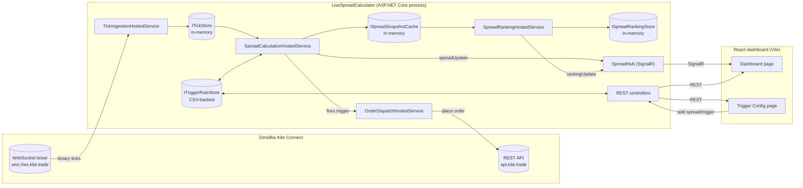

# SpreadTrader - Technical Architecture

This document describes what the system does, how the pieces fit together, and the reasoning
behind the main design decisions. For step-by-step setup/run instructions see `README.md` -
this document is the "how and why it's built this way" companion to that.

## 1. What this system does

SpreadTrader watches calendar spreads (e.g. a stock's July future vs its August future) on the
NSE/NFO segment, live, via Zerodha's Kite Connect API. For each configured pair of contracts it:

1. Streams tick-by-tick market depth over a WebSocket.
2. Computes the spread as `FarLeg.BestAsk - NearLeg.BestAsk` (best **ask** price, not last
   traded price - see §5).
3. Ranks every spread by `|spread %|` on a slow timer, so "what's moving the most right now"
   is visible without staring at a wall of numbers.
4. Evaluates user-defined trigger rules against the live spread value.
5. When a rule fires, dispatches a basket order (one or two legs) through Kite's order API.
6. Pushes all of the above to a React dashboard in real time over SignalR.

Nothing about market data itself is persisted - it only ever exists in process memory, and is
recomputed from the next tick after any restart. Configuration is the exception: spread
definitions and trigger rule definitions are each written to their own CSV file so your setup
survives a restart (see §7).

## 2. High-level architecture



Everything inside the `Api` box runs **in one process**. This is deliberate, not a
simplification taken for lack of time - see §8 (Singleton constraint).

## 3. Projects and what each one owns

| Project | Type | Owns |
|---|---|---|
| `SpreadTrader.Core` | class library | Domain models (`Tick`, `SpreadDefinition`, `SpreadSnapshot`, `SpreadRanking`, `TriggerRule`, `TriggerEvent`, order request/result types) and the interfaces everything else codes against (`ITickStore`, `ISpreadDefinitionStore`, `ISpreadSnapshotCache`, `ISpreadRankingStore`, `ITriggerRuleStore`, `ISpreadPublisher`, `ITriggerEventSink`, `IOrderGateway`), plus their default (in-memory / CSV) implementations. No dependency on ASP.NET Core, Kite, or anything external. |
| `SpreadTrader.KiteIntegration` | class library | Everything that talks to Zerodha: `KiteAuthService` (login URL + request-token exchange), `InstrumentMasterService` (instrument CSV download/cache/futures export), `KiteTickPacketParser` + `KiteTickerClient` (the binary WebSocket protocol, reconnect/resubscribe logic), `KiteOrderGateway` (rate-limited REST order placement). Depends on `SpreadTrader.Core` only. |
| `SpreadTrader.Engine` | class library | The four hosted (background) services that make up the live pipeline - see §4. Depends on `Core` and `KiteIntegration`. Not a standalone executable - `Program.cs`/`Worker.cs` in this project are empty placeholders; the services are registered directly into the Api project's DI container. |
| `LiveSpreadCalculator` | ASP.NET Core Web Api | Hosts everything: wires the entire DI graph (`Program.cs`), exposes REST controllers, hosts the SignalR hub, and is the one process you actually run for the backend. |
| `SpreadTrader.Dashboard/spreadtrader.dashboard.client` | React (Vite) SPA | The UI - see §9. |

`SpreadTrader.Core` and `SpreadTrader.KiteIntegration` still contain a leftover `Class1.cs`
stub from project scaffolding - harmless, safe to delete whenever.

## 4. The Engine pipeline

Four `BackgroundService`s, registered as singletons, running for the life of the process:

1. **`TickIngestionHostedService`** - on startup, resolves every configured spread's near/far
   tradingsymbols to Kite `instrument_token`s (via `InstrumentMasterService`), then opens and
   owns the **single** WebSocket connection to Kite (`KiteTickerClient`), subscribed in `"full"`
   mode. Every tick received is written into `ITickStore` (a `ConcurrentDictionary`). Also
   exposes `ResolveAndSubscribeAsync(spread)`, called by `SpreadsController` when a new spread
   is added at runtime, so new symbols start streaming immediately without a restart.

2. **`SpreadCalculationHostedService`** - on a timer (`Engine:SpreadRecalculationIntervalMs`,
   default 300ms), reads the latest tick for each spread's two legs from `ITickStore`, computes
   `SpreadValue = FarAsk - NearAsk` and `SpreadPercent = SpreadValue / NearAsk * 100`, always
   updates `ISpreadSnapshotCache` (so the value is available even between "changed" pushes), and
   - if the value actually changed since last cycle - adds it to a batch pushed to the dashboard
   as one `"spreadUpdate"` SignalR message. In the same pass, evaluates every trigger rule
   attached to that spread (see §6) and, if one fires, publishes a `TriggerEvent` to both the
   SignalR hub (`"triggerFired"`) and an internal channel that `OrderDispatchHostedService`
   consumes.

3. **`SpreadRankingHostedService`** - on a much slower timer
   (`Engine:RankingIntervalMinutes`, default 3), reads every spread's latest snapshot from
   `ISpreadSnapshotCache`, sorts by `|SpreadPercent|` descending, assigns a 1-based rank, stores
   the result in `ISpreadRankingStore`, and pushes it as `"rankingUpdate"`. Deliberately
   decoupled from the fast recalculation loop - re-sorting the whole spread list every 300ms
   would just flicker; a "what's moving the most" summary only needs to update every few
   minutes.

4. **`OrderDispatchHostedService`** - consumes fired `TriggerEvent`s off an internal
   `System.Threading.Channels.Channel<T>` (decoupling order placement from tick processing, so a
   slow/erroring Kite API call never blocks the tick loop), builds one or two `OrderLegRequest`s
   per event (direction resolved per §6), and dispatches each sequentially through
   `IOrderGateway`, which internally paces itself under Kite's order-placement rate limit.

## 5. Why bid/ask depth, not last traded price

Trigger thresholds are judged against live market depth, never last traded price (LTP) - LTP
only updates when a trade actually happens and can be stale between prints. But it's also not a
flat ask-vs-ask comparison: `SpreadCalculationHostedService.RunCycleAsync` first compares the two
legs' **ask** prices to decide direction (near month in premium -> you'd sell it; at a discount
-> you'd buy it - see §6), then prices each leg on the side you'd actually trade it - the leg
you'd **buy** at its **ask** (what you'd pay), the leg you'd **sell** at its **bid** (what you'd
receive). This makes `SpreadValue` the realistically executable spread, not an optimistic number
that ignores the bid/ask cost of actually putting the trade on. If the bid needed to price a sell
leg hasn't arrived yet (bid depth updates lag ask depth, especially on far-month contracts), the
service falls back to that leg's ask rather than hiding the spread entirely - `Direction` on the
snapshot is suffixed `"(bid pending)"` in that case so the UI can show it's a provisional value.

Kite only includes market depth in **`"full"`** ticker mode (`Kite:TickerMode` in
`appsettings.json`) - `"quote"`/`"ltp"` modes carry LTP/OHLC but no bid/ask at all.
`KiteTickPacketParser` reads the first bid/offer entries out of the 184-byte full-mode packet
(bytes 68-72 and 128-132 respectively) into `Tick.BestBidPrice` / `Tick.BestAskPrice`. Full mode
costs more bandwidth/CPU than quote mode (depth changes push extra ticks) - an acceptable
tradeoff at ~100-200 instruments, worth reconsidering if the instrument count grows much
further.

## 6. Trigger evaluation and order direction

A `TriggerRule` has an `Operator` (`>=` or `<=`) and a `Threshold` against `SpreadValue` (or
`SpreadPercent`, when `ThresholdIsPercent` is set) - a plain signed comparison value, not a
deviation magnitude. Two extra pieces of state make repeated firing safe:

- **`IsArmed`** - a rule only fires while armed. After firing, it disarms. If `OneShot` is true
  (the default), it also disables itself entirely and needs a manual re-enable (which re-arms
  it) before it can fire again. If `OneShot` is false, `MaxFireCount` takes over instead: the
  rule schedules exactly that many total shots, firing the next one as soon as the condition is
  true again and the previous shot's basket dispatch has resolved (filled or rejected - see
  `TriggerInFlightTracker`), with no re-arm/hysteresis wait required. (An older "stand
  indefinitely, re-arm once the spread retreats past a buffer" mode - `RearmBuffer` - existed
  here previously and has since been removed, including its column in `triggers.csv`.)
- **`MinFireIntervalPerRuleMs`** - a floor on how often *any* rule can re-fire, independent of
  arming, as a last-resort guard against a burst of duplicate orders off one noisy price move.

**Order direction** is always taken directly from the rule's fixed `NearLegAction`/`FarLegAction`
(`None`/`Buy`/`Sell`, set explicitly when the rule is created) - `OrderDispatchHostedService.
BuildLegs` uses them as-is. An earlier "auto-direction" mode (`AutoDirectionFromSpreadSign`),
which instead decided which leg to buy/sell live from the spread's premium/discount sign at fire
time, has since been removed from the model, the CSV, and every trigger-creation UI.

Every rule mutation (fired, re-armed, enabled/disabled) calls `ITriggerRuleStore.Upsert(rule)`
again, which is what keeps the CSV file (§7) in sync with runtime state, not just rule
definitions.

## 7. Persistence model

| Data | Where it lives | Survives a restart? |
|---|---|---|
| Live ticks | `ITickStore` (in-memory `ConcurrentDictionary`) | No - repopulated from the next ticks after reconnecting to Kite |
| Latest spread snapshot per spread | `ISpreadSnapshotCache` (in-memory) | No |
| Latest ranking | `ISpreadRankingStore` (in-memory) | No |
| Spread definitions (which symbols form a spread) | `ISpreadDefinitionStore` -> `CsvSpreadDefinitionStore`, file at `Storage:SpreadsCsvPath` (default `App_Data/spreads.csv`) | **Yes** - only the identifying fields (id, underlying, each leg's trading symbol/exchange); InstrumentToken/LotSize/TickSize are always re-resolved live from the instrument master at startup, never persisted |
| Trigger rules (definitions + arm/fire state) | `ITriggerRuleStore` -> `CsvTriggerRuleStore`, file at `Storage:TriggersCsvPath` (default `App_Data/triggers.csv`) | **Yes** |
| Exit trigger rules (same shape, kept in a separate store/file so they can never mix with entry rules) | `IExitTriggerRuleStore` -> `CsvExitTriggerRuleStore`, file at `Storage:ExitTriggersCsvPath` (default `App_Data/exit_triggers.csv`) | **Yes** |
| Futures symbol list | Written to `Storage:FuturesCsvPath` (default `App_Data/futures_instruments.csv`) when you click "Sync symbols from Kite"; also kept in `InstrumentMasterService`'s in-memory cache for 12h | File: yes. In-memory cache: no (re-downloads on demand) |
| Kite access token | `KiteSession` (in-memory, singleton) | No - and wouldn't help anyway, since Kite invalidates it daily regardless |

`CsvTriggerRuleStore` is intentionally simple: the *entire* rule set is rewritten to a temp file
and moved over the real one on every single change. That's correct and safe at the scale of
tens/low-hundreds of rules, and avoids partial-write corruption, but it is **not** a design that
would hold up under high write concurrency or a large rule count. If that ever becomes a
problem, swap the implementation registered for `ITriggerRuleStore` in `Program.cs` for a real
database - nothing else in the codebase needs to change, since everything else only depends on
the `ITriggerRuleStore` interface.

## 8. Why the Engine runs as one singleton process

Kite Connect caps a single API key at **3 WebSocket connections**, and `TickIngestionHostedService`
opens exactly one and holds it for the process lifetime. Running more than one instance of the
Api would mean:

- Multiple WebSocket connections competing for the same 3-connection cap.
- The same trigger firing (and the same order being placed) more than once, since each instance
  would independently evaluate the same rules against the same market data.

So: **the Api must run as a single instance.** It's registered as ordinary ASP.NET Core
singletons, not anything distributed-systems-aware, so there's no built-in leader election or
guard against accidentally running two copies - that's on the deployment configuration (don't
set replica count > 1).

If this is ever split into its own process (e.g. to let the web/SignalR tier scale
independently), the seam is already there: the Engine only depends on the abstractions in
`SpreadTrader.Core` (`ITickStore`, `ISpreadPublisher`, `ITriggerEventSink`, `IOrderGateway`).
Swap the SignalR-backed publisher/sink for a message-queue-backed one and the Engine can move to
its own container without any changes to the Engine code itself.

## 9. Frontend architecture

React 19 + Vite, plain JavaScript (no TypeScript), client-side routed with `react-router-dom`.

- **`App.jsx`** - top-level shell. Owns the SignalR connection (`useSpreadHub` hook) and the
  spread-definitions list, both of which both pages need; renders the nav bar and status pills
  (live feed state, Kite auth state) once, outside the router outlet.
- **`hooks/useSpreadHub.js`** - opens the SignalR connection to `/hubs/spreads`, seeds initial
  state from `GET /api/spreads/snapshot` and `GET /api/spreads/ranking` (so the UI isn't empty
  while waiting for the first push after a page load/reconnect), then keeps `spreads` (by id),
  `ranking` (ordered array), and `triggerEvents` (rolling last-50 feed) updated live via the
  `"spreadUpdate"`, `"rankingUpdate"`, and `"triggerFired"` events.
- **`pages/DashboardPage.jsx`** (route `/`) - read-only: `RankingPanel` (top movers by
  |spread %|), `SpreadGrid` (every configured spread's live ask prices and spread value),
  `TriggerFeed` (recent fires). No configuration controls live here on purpose.
- **`pages/TriggerConfigPage.jsx`** (route `/triggers`) - all configuration: a "Sync symbols
  from Kite" button (`POST /api/instruments/futures/fetch-all`, then reloads the futures list),
  `SpreadList`/`AddSpreadForm` (the latter switches between a dropdown picker fed by the synced
  futures list and a manual-entry fallback), `TriggerList`/`TriggerForm`.
- **`api.js`** - thin fetch wrapper, one function per REST endpoint. All calls use relative
  paths (`/api/...`); `vite.config.js` proxies those (and `/hubs/...`) to the Api during `npm
  run dev`, and the same relative paths keep working in production behind the nginx config in
  `SpreadTrader.Dashboard/spreadtrader.dashboard.client/nginx.conf`, which reverse-proxies both
  to the Api container.

## 10. API reference

All endpoints are under the Api project; Swagger UI is available at `/swagger` in Development.

| Method | Path | Purpose |
|---|---|---|
| GET | `/api/auth/login-url` | Returns the Kite login URL to redirect the browser to |
| GET | `/api/auth/status` | `{ isAuthenticated }` - whether a Kite access token is currently held |
| GET | `/api/auth/callback` | Kite redirects here with `request_token` after login; exchanges it for an access token, then redirects back to `Dashboard:BaseUrl` |
| GET | `/api/instruments/futures?underlying=&exchange=` | Futures contracts for one underlying, ordered by expiry |
| POST | `/api/instruments/futures/fetch-all?exchange=` | Downloads/refreshes the instrument master, filters to futures only, saves to the futures CSV |
| GET | `/api/instruments/futures/all?exchange=` | Lists cached futures contracts (for the symbol picker) |
| GET | `/api/spreads` | All configured spread definitions |
| GET | `/api/spreads/snapshot` | Latest known value for every spread (for initial page load) |
| GET | `/api/spreads/ranking` | Latest `|spread %|` ranking |
| POST | `/api/spreads` | Create/replace a spread; resolves instrument tokens and subscribes the ticker immediately |
| DELETE | `/api/spreads/{id}` | Remove a spread |
| GET | `/api/triggers?spreadId=` | All trigger rules, optionally filtered to one spread |
| POST | `/api/triggers` | Create a trigger rule |
| POST | `/api/triggers/{id}/enable` / `/disable` | Toggle a rule (re-persists to CSV) |
| DELETE | `/api/triggers/{id}` | Remove a rule |
| GET | `/healthz` | Liveness probe (used by the Dockerfile `HEALTHCHECK`) |
| WS | `/hubs/spreads` | SignalR hub - pushes `spreadUpdate`, `rankingUpdate`, `triggerFired` |

## 11. Configuration reference

`LiveSpreadCalculator/appsettings.json`:

```json
{
  "Kite": {
    "ApiKey": "",
    "ApiSecret": "",
    "AccessToken": "",
    "WsUrl": "wss://ws.kite.trade",
    "RestBaseUrl": "https://api.kite.trade",
    "TickerMode": "full"
  },
  "Engine": {
    "SpreadRecalculationIntervalMs": 300,
    "MinFireIntervalPerRuleMs": 2000,
    "RankingIntervalMinutes": 3
  },
  "Dashboard": { "BaseUrl": "https://localhost:63061" },
  "Storage": {
    "TriggersCsvPath": "App_Data/triggers.csv",
    "FuturesCsvPath": "App_Data/futures_instruments.csv"
  }
}
```

Any of these can be overridden with environment variables using ASP.NET Core's
`Section__Key` convention (e.g. `Kite__ApiKey`), which is how secrets are meant to be supplied
in Docker/cloud deployments instead of editing the file - see `README.md`.

## 12. Which projects you need to run

Two, and only two, need to be running for the system to work:

1. **`LiveSpreadCalculator`** (the ASP.NET Core Api) - `dotnet run` from that folder. This
   single process *is* the backend: it hosts the REST API, the SignalR hub, and all four Engine
   background services (ticker ingestion, spread calc, ranking, order dispatch) together. There
   is no separate backend process to start.
2. **`spreadtrader.dashboard.client`** (the React dashboard) - `npm install` once, then `npm run
   dev` from `SpreadTrader.Dashboard/spreadtrader.dashboard.client`. This is the UI you open in
   a browser.

`SpreadTrader.Core`, `SpreadTrader.KiteIntegration`, and `SpreadTrader.Engine` are class
libraries - you never run them directly, they're compiled into `LiveSpreadCalculator` as project
references. You do not need to (and currently cannot, since it hasn't been generated) run
`SpreadTrader.Dashboard.Server` - that project is referenced in the `.sln` but has no files on
disk; it isn't part of the working system. Full step-by-step run/build/deploy instructions,
including Docker, are in `README.md`.
